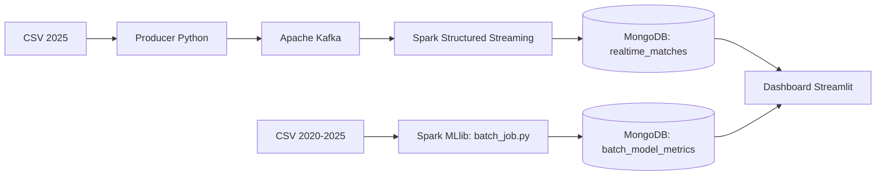

# Tennis Big Data Project | Sinner vs Alcaraz

**Progetto universitario di gruppo** · Data Engineering · Big Data · Streaming · Machine Learning · Data Visualization

## Panoramica

Progetto sviluppato per analizzare e confrontare le prestazioni di **Jannik Sinner e Carlos Alcaraz** attraverso una pipeline di elaborazione dati, una simulazione di streaming e una dashboard interattiva. Le informazioni provengono dai file CSV del progetto relativi alle stagioni **2020–2025**.

La parte *batch* utilizza i dati storici per addestrare un modello di classificazione con Spark MLlib e produrre una simulazione relativa al 2026. La parte *streaming* riproduce, a intervalli regolari, l'arrivo degli incontri del 2025 tramite Kafka: **non si tratta di un collegamento a un feed sportivo live**.

Il lavoro è stato realizzato da un **gruppo di tre studenti**. I file raccolgono il risultato del progetto comune; i singoli contributi vanno attribuiti sulla base delle attività effettivamente svolte.

### Dati e risultati documentati

| Indicatore | Evidenza nel progetto |
| --- | ---: |
| Partite nei sei CSV 2020–2025 | **680** |
| Variabili per ciascun CSV | **44** |
| Partite presenti nel CSV 2025, usato dal producer Kafka | **136** |
| Intervallo di emissione configurato dal producer | **0,5 secondi/partita** |
| Trigger di Spark Structured Streaming | **1 secondo** (configurato, non latenza garantita) |
| Accuracy del classificatore batch | **77,99%** (log dell'esecuzione originale) |
| Matrice di confusione riportata | TP=110, TN=92, FP=28, FN=29 |

I valori si riferiscono ai file e ai **log dell'esecuzione originale**, non a un nuovo addestramento eseguito per questo README.

## Architettura



- **Docker Compose**: orchestra Kafka, ZooKeeper, Spark master/worker, Jupyter, MongoDB, Mongo Express e Streamlit.
- **`scripts/ingestion.py`**: legge `data/2025.csv` e invia una partita ogni 0,5 secondi sul topic Kafka `tennis-live`.
- **`scripts/streaming_job.py`**: legge il topic con Spark Structured Streaming, interpreta i messaggi JSON e salva micro-batch in MongoDB (`tennis_db.realtime_matches`).
- **`scripts/batch_job.py`**: combina i CSV storici, costruisce le variabili del modello, addestra una Logistic Regression con Spark MLlib e salva metriche e simulazione in `tennis_db.batch_model_metrics`.
- **`scripts/app.py`**: dashboard Streamlit per statistiche, grafici, comparazioni e consultazione dei risultati del modello.

La dashboard avvia i tre job tramite processi Python quando si preme **«AVVIA SIMULAZIONE COMPLETA»**. Le componenti del sistema non vengono avviate tutte dal solo comando `docker compose up`.

## Modello Machine Learning

L'implementazione batch utilizza **Logistic Regression** in una `Pipeline` Spark con `StringIndexer`, `VectorAssembler` e `StandardScaler`. Le variabili considerate nel codice sono:

- Differenza di ranking ATP (`Rank_Diff`)
- Differenza di punti ranking (`Points_Diff`)
- Superficie di gioco (`Surface_Index`)

L'esperimento crea un esempio positivo e uno negativo per ogni incontro, invertendo il punto di vista del vincitore e dello sconfitto, e applica successivamente uno *split* casuale 80/20. I log riportano un'accuracy del **77,99%**.

### Interpretazione corretta e limiti

1. **Rischio di dipendenza tra train e test**: le due osservazioni derivate dalla stessa partita vengono create **prima** dello split e possono finire in insiemi differenti. La stima dell'accuracy potrebbe quindi essere ottimistica. Una valutazione più rigorosa richiederebbe uno split per partita originale e, idealmente, una separazione temporale.
2. **Simulazione 2026 illustrativa**: in `batch_job.py` le probabilità del modello sono corrette con coefficienti euristici per superficie e campione in carica; vengono usati anche punti ranking iniziali definiti nel codice. Questi risultati **non sono previsioni sportive validate** né probabilità calibrate.
3. **Streaming simulato**: Kafka riproduce eventi storici del 2025. Il trigger da 1 secondo definisce una cadenza richiesta di micro-batch, non un tempo massimo garantito di elaborazione: il log registra anche batch più lenti.
4. **Riproducibilità**: l'esecuzione completa richiede i CSV originali e un ambiente Docker compatibile. Le versioni dell'immagine di base non sono completamente fissate nel Dockerfile originale.

Queste note fanno parte dell'analisi critica del prototipo e non modificano i risultati conseguiti durante il progetto universitario.

## Struttura del repository

```text
tennis-big-data-project/
├── scripts/
│   ├── app.py
│   ├── batch_job.py
│   ├── ingestion.py
│   └── streaming_job.py
├── data/
│   └── README.md              # Indicazioni sui file locali
├── Dockerfile
├── docker-compose.yml
├── requirements.txt
├── .gitignore
└── README.md
```

**I CSV e le fotografie non sono inclusi nell'archivio destinato alla pubblicazione** finché non viene verificata la loro provenienza e l'autorizzazione alla redistribuzione. L'archivio locale separato conserva invece una copia dei materiali forniti per il lavoro personale.

## Avvio in locale

**Prerequisiti:** Docker Desktop con Docker Compose e risorse sufficienti per eseguire Kafka, Spark, MongoDB e Streamlit.

1. Inserire nella cartella `data/` i file `2020.csv`, `2021.csv`, ..., `2025.csv` usati per il progetto (stesso schema, nomi invariati). Eventuali immagini `sfondo.jpeg`, `ao.jpeg`, `rg.jpeg`, `wim.jpeg`, `uo.jpeg` sono facoltative per alcune parti grafiche.
2. Dal terminale, nella cartella principale del repository, eseguire:

   ```bash
   docker compose up --build -d
   ```

3. Aprire **http://127.0.0.1:8501** e premere **AVVIA SIMULAZIONE COMPLETA**. Attendere i processi di caricamento e il training batch.
4. Per visualizzare i messaggi dei servizi e l'eventuale token Jupyter:

   ```bash
   docker compose logs -f dashboard
   docker compose logs jupyter-spark
   ```

5. Arrestare i servizi:

   ```bash
   docker compose down
   ```

**Sicurezza:** il file Compose qui incluso è predisposto per **uso locale**: tutte le porte pubblicate sono vincolate a `127.0.0.1`; il token di accesso Jupyter non è disabilitato. Non distribuire la dashboard come servizio Internet senza prima aggiungere autenticazione e riprogettare il controllo dei processi. Mongo Express è incluso solo come strumento di sviluppo locale.

**Verifica:** gli script Python sono stati controllati sintatticamente e la struttura è stata confrontata con le dipendenze dei file. Non è stato effettuato un avvio completo dei container Docker né un nuovo addestramento in questo ambiente; il funzionamento end-to-end non viene quindi garantito.

## Competenze rappresentate

**Python · ETL e Data Processing · Apache Kafka · Spark Structured Streaming · Spark MLlib · MongoDB · Docker Compose · Streamlit · Visualizzazione e interpretazione dei risultati · Documentazione tecnica**.

## Note sul progetto

Repository a scopo **didattico e di portfolio**. La dashboard contiene anche visualizzazioni e simulazioni sperimentali basate sui dati storici; non costituisce un servizio di risultati sportivi in tempo reale, né uno strumento di previsione affidabile per scommesse o decisioni economiche. Le fonti e le condizioni di licenza dei dataset e delle fotografie devono essere verificate prima di una loro pubblicazione.
